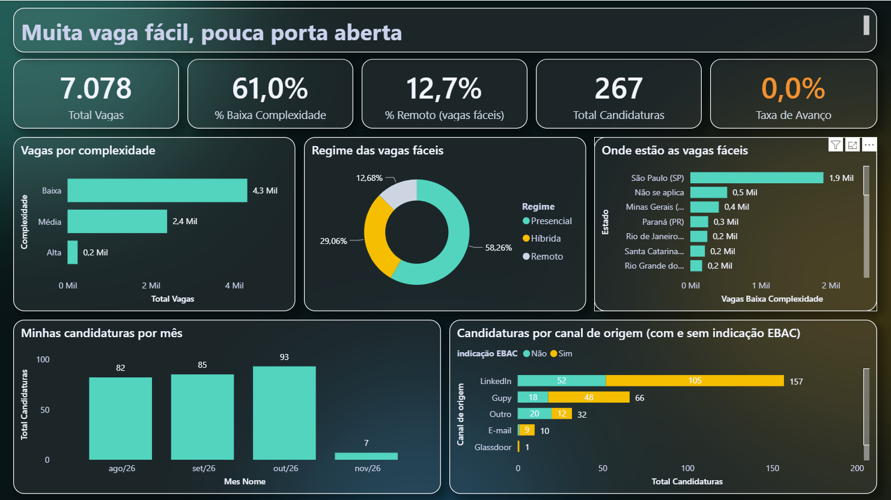

# Muita vaga fácil, pouca porta aberta
### O mercado de vagas de Analista de Dados no Brasil × 267 candidaturas reais



## O problema

Entre agosto e novembro de 2026 eu me candidatei a **267 vagas** de Analista de Dados, BI e áreas próximas. Nenhuma passou da triagem.

Ao mesmo tempo, a planilha de vagas da EBAC mostra milhares de vagas de **baixa complexidade**, que em tese são as mais acessíveis para quem está começando. Este projeto tenta responder:

> **Se existem tantas vagas fáceis, por que é tão difícil conseguir uma oportunidade?**

## Perguntas de negócio

1. Qual a proporção de vagas de baixa complexidade no mercado de Analista de Dados?
2. Onde essas vagas estão e em qual regime (presencial, híbrido, remoto)?
3. Qual foi o resultado das minhas candidaturas e de onde elas vieram?
4. A indicação da EBAC fez diferença no resultado?

## Dados

| Fonte | Linhas | Descrição |
|---|---|---|
| `vagas.csv` | 23.393 (7.078 de Analista de Dados) | Planilha de vagas compartilhada pela EBAC, out/2024 a nov/2026 |
| `vagas_aplicadas.csv` | 267 | Minha planilha de acompanhamento de candidaturas, 06/08 a 03/11/2026 |

## Ferramentas

- **Python (Pandas)**: limpeza, exploração e exportação → `main.py`
- **Power BI**: modelo com tabela calendário, medidas DAX e dashboard → `Dashboard_Mercado_Vagas_alinhado.pbix`

## Tratamento de dados

Dado real é bagunçado. Os problemas encontrados e como foram resolvidos:

| Problema | Solução |
|---|---|
| Primeira linha do CSV vazia | `read_csv(header=1)` |
| Categoria duplicada: "Híbrido" e "Híbrida" | `.replace('Híbrido', 'Híbrida')` |
| Nomes de coluna com espaços/acentos invisíveis (`KeyError`) | `.str.normalize('NFC').str.strip()` |
| Coluna do nome da vaga chamada `w` | `.rename()` |
| Quebras de linha `\r\n` no nome da vaga | `.str.strip()` |
| Data inexistente: `31/09/2026` | Corrigida para `30/09/2026` |
| Dia e mês invertidos: `8/7/2026` (era 7 de agosto) | Corrigida para `7/8/2026` |
| Carimbos com e sem horário misturados | `.str[:10]` + `pd.to_datetime(format='%d/%m/%Y')` |
| 131 vagas sem complexidade | Mantidas no total, excluídas do gráfico de complexidade |
| "Não se aplica" no estado | Confirmado com `crosstab`: 522 de 525 são vagas remotas |
| Status desatualizado ("Esperando resposta") | Atualizado para "Negada": todas tiveram retorno negativo |

## Principais resultados

**Mercado (planilha EBAC, 7.078 vagas de Analista de Dados)**
- **61%** das vagas são de **baixa complexidade** (4.315)
- Entre as vagas fáceis, só **12,7% são remotas**; **58%** exigem presença
- **44%** estão em São Paulo; o Sudeste concentra **mais de 60%**

**Minhas candidaturas (267)**
- **0% de avanço**: todas pararam na triagem de currículo
- Volume crescente: 82 (ago) → 85 (set) → 93 (out), cerca de **3 por dia**
- **59%** das vagas foram encontradas no LinkedIn e **25%** na Gupy
- **66%** tiveram indicação da EBAC, e nenhuma avançou

## Conclusões

1. **Vaga "fácil" não é vaga acessível.** A maioria exige presença e está concentrada no Sudeste, o que reduz muito o mercado real de cada candidato.
2. **Remoto é raro e disputado.** Recortando só o período das minhas candidaturas, a fatia remota das vagas fáceis cai para **8%**.
3. **Volume não resolveu.** Aumentar o número de candidaturas não mudou o resultado; o gargalo está na triagem.
4. **A indicação sozinha não destravou a triagem** neste conjunto.

## Recomendações (para mim e para quem está começando)

- Priorizar vagas **presenciais ou híbridas na própria região**, onde a concorrência é menor
- Trocar volume por **candidaturas personalizadas** (currículo ajustado à vaga, contato com recrutador)
- Registrar **em qual etapa** cada processo parou, para medir onde está o gargalo
- Usar projetos de portfólio como este para mostrar **trabalho real com dado sujo**

## Limitações

- A planilha da EBAC é colaborativa e cobre **out/2024 a nov/2026**; o total é acumulado, não um retrato do mercado aberto hoje
- Há possíveis duplicatas (2 linhas idênticas, 45 links repetidos), irrelevantes para as proporções
- `Canal de origem` indica **onde a vaga foi encontrada**, não onde a candidatura foi feita
- 4 vagas aparecem duas vezes nas candidaturas (mesma empresa e cargo em datas diferentes, provavelmente republicadas)
- Amostra pequena em alguns canais (Glassdoor e Infojobs têm 1 candidatura cada)
- O status das candidaturas foi atualizado manualmente com base no retorno recebido

## Como reproduzir

```bash
pip install pandas
python main.py
```

O script gera `vagas_limpas.csv` e `candidaturas_limpas.csv`. Abra o `Dashboard_Mercado_Vagas_alinhado.pbix` no Power BI Desktop e clique em **Atualizar**.

> A base original da EBAC (`vagas.csv`) **não está no repositório** porque contém e-mails de quem cadastrou as vagas. O repositório traz a versão tratada (`vagas_limpas.csv`), sem dados pessoais, que já alimenta o dashboard.

## Estrutura

```
Projeto_dados/
├── main.py                       # limpeza e análise em Python
├── vagas_aplicadas.csv           # minhas candidaturas (original)
├── vagas_limpas.csv              # base EBAC tratada
├── candidaturas_limpas.csv       # candidaturas tratadas
├── Dashboard_Mercado_Vagas_alinhado.pbix  # dashboard Power BI
├── tema_glass_vagas.json         # tema do Power BI
├── fundo_glass.png               # fundo do dashboard
└── dashboard.png                 # imagem do dashboard
```

## Autor

**Victor Bandeira**, Analista de Dados
[LinkedIn](https://www.linkedin.com/in/victor-bandeira-448b1a206) · [GitHub](https://github.com/Bandeira1)
